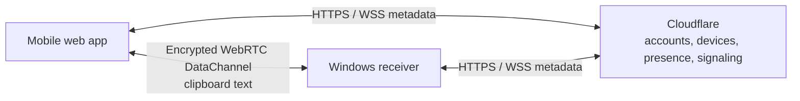

<h1 align="center">
  Copyrade<br>
  <sub>Your clipboard comrade.</sub>
</h1>

<p align="center">
  <a href="https://copyrade-staging.abdullahijaz-m.workers.dev"></a><br>
  <a href="docs/getting-started.md"></a>
  <a href="docs/compatibility.md"></a>
  <a href="LICENSE"></a><br>
  <a href="docs/architecture.md"></a>
  <a href="docs/architecture.md"></a>
  <a href="docs/architecture.md"></a>
  <a href="docs/architecture.md"></a>
  <a href="docs/architecture.md"></a>
</p>

**Copy on your phone. Paste on Windows.**

Copyrade sends text from your phone to your Windows clipboard. No messaging
yourself, file uploads, or cloud clipboard history.

### [Launch Copyrade →](https://copyrade-staging.abdullahijaz-m.workers.dev)

[Setup guide](docs/getting-started.md) ·
[Compatibility and tested devices](docs/compatibility.md)

> **Early development:** Phone-to-Windows text transfer is working. The Windows
> receiver must currently be built from source; a downloadable app is planned.

## How it works

1. **Copy** or type text on your phone.
2. **Send** it to a registered Windows PC through Copyrade.
3. **Paste** anywhere in Windows with `Ctrl+V`.

## Features

| What Copyrade can do | Availability |
| --- | --- |
| Send text and links from iPhone to the Windows clipboard | Available |
| Find registered PCs, see when they are online, and reconnect | Available |
| Transfer clipboard content over an encrypted peer-to-peer connection | Available |
| Send JPEG and PNG clipboard images to Windows | Available |
| Automatically connect when only one registered PC is online | Planned |
| Run quietly as a Windows background and tray app | Available |
| Share through an iPhone Shortcut or the iOS share menu | Planned |
| Use a dedicated mobile app | Planned |
| Pair without an account or sign in with email and password | Planned |
| Choose local/direct-only networking or use an encrypted relay fallback | Planned |

See [compatibility](docs/compatibility.md) for verified devices and connection
help, or [report a problem](https://github.com/abdullah-mi/Copyrade/issues/new).

## Why Copyrade

- **Private by design:** Copyrade does not upload clipboard contents to its
  backend or maintain a cloud clipboard history.
- **Approved devices:** account sign-in, browser-approved enrollment, and
  revocable device credentials control which PCs can receive content.
- **Encrypted transport:** clipboard payloads travel over an encrypted WebRTC
  DataChannel; the backend coordinates the connection.
- **Meaningful confirmation:** the sender receives an acknowledgement after
  Windows updates its clipboard, not merely after a network packet arrives.

## Getting started

Copyrade is not yet available as a downloadable Windows app. For now, you can
try it by running the Windows receiver from source. This takes a few commands
in PowerShell or another terminal.

### Requirements

- Windows;
- [Node.js 24 or later](https://nodejs.org/en/download) (the installer includes npm);
- [Git](https://git-scm.com/downloads);
- a Google or GitHub account for sign-in.

Clone the project, install its dependencies, build the shared packages, and
start the receiver:

```bash
git clone https://github.com/abdullah-mi/Copyrade.git
cd Copyrade
npm ci
npm run build:shared
npm start --workspace @copyrade/desktop
```

The receiver connects to Copyrade's hosted service. The first time it runs,
choose **Register this PC**; Copyrade opens the web app so you can sign in and
approve the device. Then open [Copyrade](https://copyrade-staging.abdullahijaz-m.workers.dev)
on your phone, select the online PC, connect, and paste your clipboard.

For the unauthenticated local room-code diagnostic, HTTPS phone access,
individual workspace commands, or local control-plane setup, use the
[developer getting-started guide](docs/getting-started.md).

## Privacy and architecture



- Copyrade uses Cloudflare to handle accounts, device pairing, online status,
  and connection setup.
- Clipboard content travels between devices over an encrypted WebRTC
  DataChannel. It is not stored in Copyrade's backend or in a cloud clipboard
  history.
- Connections may fail on restrictive networks because TURN relay fallback is
  not yet implemented.

Read the full [architecture](docs/architecture.md) and
[security and privacy boundaries](docs/security.md).

## Roadmap

| Area | Status | Technical work |
| --- | --- | --- |
| Accounts and devices | Complete | Google/GitHub sign-in, verified-email linking, browser-approved enrollment, protected credentials, discovery, presence, and revocation |
| Connections | Complete | Account-scoped signaling, automatic connection requests to a selected PC, disconnect handling, and explicit reconnects |
| Text transfer | Complete | Bounded transfers, native Windows clipboard writes, and delivery acknowledgements |
| Browser paste flow | Complete | Text, URLs, Safari PNG images, and Photos-derived JPEG images |
| [Image transfer](https://github.com/abdullah-mi/Copyrade/milestone/2) | In progress | JPEG/PNG delivery, integrity checks, backpressure, and native Windows clipboard writes are working; cancellation and broader testing remain |
| Automatic connection | Planned | Select and connect automatically when exactly one registered PC is available |
| [Windows alpha](https://github.com/abdullah-mi/Copyrade/milestone/3) | In progress | Tray/background behavior is working; launch at login, sleep/wake recovery, packaging, signing, and installation testing remain |
| More account options | Planned | Email/password accounts and short-lived account-less pairing codes |
| iPhone and mobile apps | Planned | Faster sharing through an iPhone Shortcut or share-menu integration, followed by a dedicated mobile app |
| Network modes | Planned | Direct-only mode, longer-term LAN-only operation, and an encrypted relay fallback for restrictive networks |
| Original files | Planned | Preserve HEIF, PDF, and other files with bounded temporary storage and cleanup |
| Compatibility | In progress | Expand Android, browser, Windows-version, sleep/wake, and network testing |

## Documentation

- [Developer getting started](docs/getting-started.md)
- [Architecture](docs/architecture.md)
- [Security and privacy](docs/security.md)
- [Compatibility](docs/compatibility.md)
- [Text transfer protocol](docs/protocol.md)
- [Unauthenticated development connection](docs/connection-spike.md)
- [Architecture decisions](docs/decisions)

## Contributing

Bug reports, technical feedback, documentation improvements, and focused pull
requests are welcome. Read [CONTRIBUTING.md](CONTRIBUTING.md) before opening a
pull request.

## License

Copyright © 2026 Abdullah Ijaz. Copyrade is licensed under the
[Apache License 2.0](LICENSE). Forks and redistributions must preserve the
license and required attribution notices.
