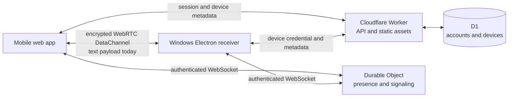

# Copyrade architecture

This document separates the deployed staging design from planned work. The
current end-to-end payload path supports bounded `text/plain` transfers only.
Browser-side image acquisition is implemented; image delivery is not.

## Staging architecture

Cloudflare is the control plane; WebRTC is the clipboard data plane:

- **Workers Static Assets** serves the React mobile build from the API origin.
- **Cloudflare Worker** handles account sessions, device enrollment, device
  authorization, ticket issuance, and API routing.
- **D1** stores account, linked identity, session, registered-device,
  revocation, and abuse-prevention records. Clipboard payloads are not stored.
- **Durable Objects** coordinate account-scoped device presence and transient
  WebRTC signaling over WebSockets. They do not carry clipboard payloads.
- **WebRTC DataChannel** carries the implemented text payload between the phone
  and Windows receiver. JPEG/PNG delivery is the next protocol milestone.

The staging deployment is
[`copyrade-staging.abdullahijaz-m.workers.dev`](https://copyrade-staging.abdullahijaz-m.workers.dev).
It is an engineering environment, not a production availability commitment.

## Identity and account linking

Copyrade assigns one immutable internal user ID and attaches login providers to
that identity. Google and GitHub sign-in are deployed. A future verified
email/password method remains planned.

Providers may be linked automatically only when both return the exact same
verified email address. An absent, private, or unverified email requires an
explicit signed-in linking flow. Copyrade does not infer identity from provider
usernames or email aliases.

See [ADR 0002](decisions/0002-identity-linking.md).

## Windows device enrollment

The Electron receiver uses a browser-approved device flow:

1. Electron requests a ten-minute enrollment and opens the staging web app.
2. The signed-in user checks the visible code and device name, then approves it.
3. Electron exchanges a separate high-entropy code for a revocable credential.
4. The main process encrypts the credential with Electron `safeStorage` on
   Windows and never exposes it to the React renderer.
5. Electron validates the credential at startup and periodically; revocation
   removes the local credential and closes matching coordinator sockets.

The visible code, exchange code, and device token are stored as keyed hashes in
D1. Device names are display metadata, not proof of identity.

See [ADR 0003](decisions/0003-device-enrollment.md).

## Authenticated signaling

1. The signed-in mobile app selects an active device owned by the account.
2. The browser and Electron independently exchange their existing
   authentication for 60-second signaling tickets.
3. Each ticket is sent as a WebSocket subprotocol value rather than in the URL.
4. The Worker validates the ticket and routes both peers to the account's
   Durable Object.
5. The coordinator consumes each ticket nonce once, matches opposite roles for
   the same device ID, and relays bounded SDP and ICE messages.
6. Clipboard text travels over the resulting WebRTC DataChannel. A matching
   ACK is sent only after the native Windows clipboard write succeeds.

This flow has passed the recorded authenticated iPhone-to-Windows staging test.
That evidence does not establish connectivity across every network.

See [ADR 0004](decisions/0004-authenticated-signaling.md) and the
[text protocol](protocol.md).

## Receiver presence

An enrolled receiver maintains a separate account-scoped presence WebSocket.
It reconnects with bounded exponential backoff and obtains a fresh signaling
ticket when the user selects that online device.

Browser observers receive only online device IDs and then refetch authorized
device metadata from the API. Presence messages do not carry clipboard data,
SDP, or ICE candidates. Electron also uses a single-instance lock so duplicate
receiver processes do not compete for one device.

See [ADR 0005](decisions/0005-persistent-device-presence.md).

## Desktop trust boundary

Electron runs its React renderer with Node.js integration disabled, context
isolation enabled, and Chromium sandboxing enabled. A narrow preload bridge
exposes typed operations. The main process checks the requesting frame and
validates clipboard text before calling Electron's native clipboard API.

The current device credential is stored under Electron's per-user `userData`
directory. It is protected with Windows DPAPI through `safeStorage`, but this
does not protect it from all malware running as the same Windows user.

## Development-only connection

`npm run dev:connection` uses a separate loopback Node signaling server and a
manually copied room code. It is unauthenticated, uses synthetic content, and is
retained only for isolated protocol development. It is not the staging
architecture described above. See the
[development connection record](connection-spike.md).

## Planned evolution

### Image clipboard transfer

JPEG and PNG representations up to 16 MiB will be chunked, integrity-checked,
and assembled in memory. Success will be acknowledged only after the native
Windows image clipboard write. This is designed but not implemented.

### Desktop lifecycle and distribution

The primary target is an installed, per-user Windows application packaged with
Electron Forge. Tray/quit behavior, opt-in startup, sleep/wake recovery,
signing, update policy, and clean-machine installer tests remain planned. There
is currently no public Windows build.

### Original files

Original-file and PDF delivery is separate from the image clipboard. It will
require exact-byte integrity, sanitized filenames, size/quota limits, explicit
ownership, and temporary-file cleanup. See
[ADR 0006](decisions/0006-desktop-storage-and-distribution.md).

### Network reliability

No TURN relay is configured. STUN-only connections can fail on restrictive
networks, and the selected ICE route was not recorded in the initial
cross-network evidence. A TURN fallback, direct-only option, and stronger
LAN-only design require separate privacy and reliability decisions.

## Architecture decisions

- [0001: Cloudflare control plane](decisions/0001-cloudflare-control-plane.md)
- [0002: Account identity and linking](decisions/0002-identity-linking.md)
- [0003: Browser-approved desktop enrollment](decisions/0003-device-enrollment.md)
- [0004: Account-scoped authenticated signaling](decisions/0004-authenticated-signaling.md)
- [0005: Persistent device presence](decisions/0005-persistent-device-presence.md)
- [0006: Desktop storage and distribution](decisions/0006-desktop-storage-and-distribution.md)
